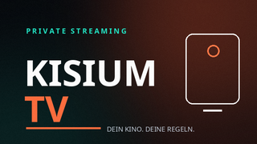
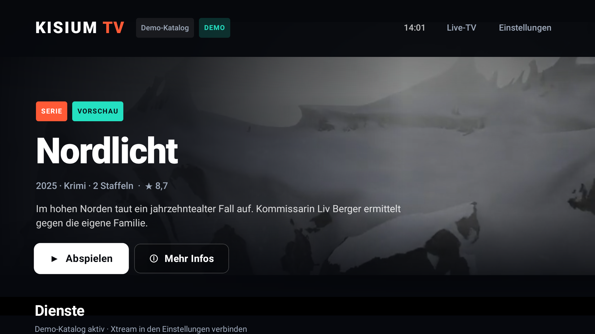

# Kisium TV



Privates Android-TV-Frontend im Netflix-Stil – eine APK für **waipu.tv Stick** und
**Amazon Fire TV**. Die App unterstützt deinen eigenen Xtream-Codes-Zugang
(Live-TV, VOD, Serien) sowie einen Netzkino-VOD-Katalog über den optionalen Proxy,
zeigt EPG Now/Next, spielt HLS/TS über Media3 und bleibt vollständig ohne
Google Play Services lauffähig.

> Persönliches Sideload-Projekt, kein Play-Store-Release. Die App enthält keinen
> DRM-Bypass und kein Account-Scraping.

> **Showcase-Repository:** Dieses Repository zeigt die Architektur und den
> vollständigen Code. Es enthält keine echten Zugangsdaten und keine
> produktive Serveradresse. Für eine eigene Instanz `your-proxy.example`
> durch die eigene Domain ersetzen.



## Status

- Android-TV-App (`de.kisium.tv`, `minSdk 21`, `targetSdk 34`) ohne GMS/Firebase.
- Netzkino-VOD-Pipeline mit 2.186 Filmen, Kategorien, Kinder-/Familien-Rails und Favoriten.
- FastAPI-Proxy mit 302-Redirect, `/catalog.json`, Admin-GUI und SQLite-WAL.
- APK, Docker-Images, `data/` und Screenshots werden **nicht** im Repository versioniert;
  sie entstehen über Gradle bzw. Docker.
- Lint: 0 Errors.

## Funktionsumfang

| Bereich | Umsetzung |
|---|---|
| UI | Jetpack Compose for TV, D-Pad-only, Fokus-Skalierung, Hero-Banner, horizontale Karussells |
| Home | „Weiterschauen“, „Jetzt live“, „Für dich“, „Neu“, „Filme“, „Serien“, Disney+-Kachel |
| Xtream | `player_api.php` für Kategorien/Live/VOD/Serien, `get.php`-M3U-Parser, `xmltv.php`-Parser |
| Player | Media3/ExoPlayer, HLS primär, TS-Fallback bei Live, Resume, Fortschritt in Room |
| EPG | Now/Next pro Sender über `get_short_epg`, Anzeige im Player |
| Settings | Server, User, Passwort (EncryptedSharedPreferences), TMDB-Key, Autoplay, Demo |
| Cache | Room für Katalog, EPG und Watch-History; Coil mit 32 MB Memory-/128 MB Disk-Cache |
| JSON-Katalog | `catalog.json` per HTTP/Datei/Content-URI, asynchron, 5-Minuten-Cache, Playback über Proxy/Xtream |
| Dienste | Disney+ und waipu.tv als Deep Link in die offiziellen Apps, sonst Hinweis + Appstore-Link |
| Branding | App-Label, Package `de.kisium.tv`, Banner, Icon, Splash, Settings-Header |

## Geräte

| Ziel | OS / API | Hardware | Widevine | Sideload |
|---|---|---|---|---|
| waipu.tv 4K Stick (SEI700WP, 1. Gen) | Android TV 11 / API 30 | Amlogic S905Y4, 4× Cortex-A35, 2 GB RAM, 8 GB | L1 | `adb connect <IP>:5555`, `adb install` |
| waipu.tv 4K Stick (2. Gen, 2025) | Android TV | Amlogic S905X5M, 3 GB RAM, 32 GB | L1 | wie oben |
| Fire TV Stick HD (2024) | Fire OS 7 / API 28 | 8 GB Speicher, wenig RAM | modellabhängig | adb oder Downloader |
| Fire TV Stick 4K Max (2. Gen) | Fire OS 8 / API 30 | 2 GB RAM, 16 GB | Widevine L1 **und** L3 | adb oder Downloader |
| Fire TV Stick 4K Plus (2025) | Fire OS 8 / API 30 | 16 GB | modellabhängig | adb oder Downloader |
| Fire TV Stick 4K Select / 4K (3. Gen 2026) | **Vega OS 2.0** | kein Android | – | **APK wird nicht installiert** |

Wichtig: Neuere Fire-TV-Modelle mit **Vega OS** sind keine Android-Forks mehr. Dort
läuft diese APK nicht. Alle Fire-OS-7/8-Geräte laufen mit `minSdk 21`/`targetSdk 34`
und ohne GMS.

Quellen: [waipu.tv 4K Stick Spezifikationen](https://www.tvsfaq.com/fr/appareil-de-streaming/waiputv-4k-stick-sei700wp),
[Android TV Guide – waipu.tv 4K Stick V2](https://www.androidtv-guide.com/pay-tv-provider/waipu-tv-stick-v2/),
[Amazon Fire TV Device Specifications](https://www.developer.amazon.com/docs/device-specs/identify-fire-tv-devices.html),
[Fire TV Streaming Media Player Specs](https://www.developer.amazon.com/docs/device-specs/device-specifications-fire-tv-streaming-media-player.html).

## Schnellstart

### Bauen

Voraussetzungen: JDK 17, Android SDK 34, Build-Tools 34.0.0.

```bash
cd kisium-tv
export ANDROID_HOME="$HOME/android-sdk"       # ggf. anpassen
printf 'sdk.dir=%s\n' "$ANDROID_HOME" > local.properties

# Nur nötig, wenn ~/.gradle nicht beschreibbar ist (z. B. Sandbox):
# export GRADLE_USER_HOME="$PWD/../.gradle-home"

./gradlew :app-tv:assembleDebug
```

Ergebnis:

```text
app-tv/build/outputs/apk/debug/app-tv-debug.apk
```

Falls der Debug-Key fehlt:

```bash
./scripts/generate-debug-keystore.sh
```

Der Build nutzt `keystore/kisium-debug.keystore` (Passwort `android`, Alias
`androiddebugkey`). Das ist ein lokaler Debug-Key, kein Release-Key.

### Installieren

```bash
adb connect 192.168.1.50:5555
adb devices
adb install -r app-tv/build/outputs/apk/debug/app-tv-debug.apk
adb shell monkey -p de.kisium.tv -c android.intent.category.LEANBACK_LAUNCHER 1
```

Ausführliche Schritte inklusive Fire TV und Launcher-Prüfung:
[docs/SIDELOAD.md](docs/SIDELOAD.md).

## Netzkino-VOD-Setup (Server)

Für den Netzkino-VOD-Stack ist kein Xtream-Panel nötig:

1. `docker compose up -d --build` im Projektroot starten.
2. Kisium TV → **Einstellungen**.
3. **Server-URL**: die Adresse des eigenen Proxy-Deployments eintragen,
   z. B. `https://your-proxy.example`.
4. **Benutzer/Passwort**: `PROXY_USERNAME` / `PROXY_PASSWORD`.
5. **KATALOG-JSON**: `https://<dein-proxy>/catalog.json`.
6. **JSON-Katalog verwenden** aktivieren, **Demo-Modus** aus, **Speichern**.

Der Proxy liefert den Katalog und leitet `/movie/...` per 302 an die
Netzkino-MP4-URL weiter. Live-TV/Serien sind in diesem VOD-Katalog nicht
separat modelliert.

## Optional: direktes Xtream-Panel

1. Kisium TV starten → **Einstellungen**.
2. Server-URL ohne `/player_api.php` eintragen, z. B. `http://192.168.1.20:8080`.
3. Benutzername und Passwort des Xtream-Panels eintragen.
4. Optional TMDB-API-Key für Beschreibungen/Backdrops.
5. **Verbindung testen**.
6. **Demo-Modus ausschalten** und **Speichern**.

Die App bildet folgende Endpunkte ab:

```text
<base>/player_api.php?username=…&password=…&action=get_live_categories
<base>/player_api.php?…&action=get_vod_categories
<base>/player_api.php?…&action=get_series_categories
<base>/player_api.php?…&action=get_live_streams[&category_id=…]
<base>/player_api.php?…&action=get_vod_streams[&category_id=…]
<base>/player_api.php?…&action=get_series[&category_id=…]
<base>/player_api.php?…&action=get_series_info&series_id=…
<base>/player_api.php?…&action=get_short_epg&stream_id=…
<base>/get.php?username=…&password=…&type=m3u_plus&output=ts
<base>/xmltv.php?username=…&password=…
```

Stream-URLs werden aus `<base>/live|movie|series/<user>/<pass>/<id>.<ext>` gebaut.
Live läuft primär als `.m3u8`; bei einem Player-Fehler versucht die App automatisch
`.ts` als Fallback.

## Disney+ und waipu.tv

Beide Dienste laufen als **Deep-Link-Kacheln** in die offiziellen Apps:

- **Disney+**: Leanback-/Launcher-Intent, sonst Hinweis mit Play-Store- und
  Amazon-Appstore-Link.
- **waipu.tv**: öffnet über `waipu://tv` direkt den Live-TV-Bereich der
  installierten waipu-App (`de.exaring.waipu`), mit Fallback auf den normalen
  App-Start. Ist die App nicht installiert, erscheint ein Hinweis.

DRM- und accountgebundene Inhalte beider Dienste werden **nicht** in der eigenen
Compose-Oberfläche abgespielt. Das ist mit den offiziellen Apps zuverlässig und
mit den Nutzungsbedingungen vereinbar. Xtream-Streams sind davon unabhängig.

### Warum keine Kodi-Addons einbetten?

Es gibt inoffizielle Kodi-Addons für waipu.tv und Disney+ (z. B.
[plugin.video.waipu](https://github.com/sunsettrack4/plugin.video.waipu) und
[SlyGuy Addons](https://github.com/matthuisman/slyguy.addons)). Sie sind keine
APIs, sondern Reverse-Engineering-Clients: OAuth-Token, interne GraphQL-/
Stream-Endpunkte und DASH + Widevine über Kodi's `inputstream.adaptive`.
Kisium TV könnte diese Mechanismen in Kotlin nachbauen, das wäre aber ein
eigenes, instabiles Projekt mit Account-, DRM- und Lizenzaufwand. Die
Deep-Link-Variante ist für den Eigenbedarf die robuste Lösung.

## Projektstruktur

```text
kisium-tv/
├── app-tv/             App, Hilt-Setup, Navigation, Screens, Manifest, Branding
├── core-ui/            Compose-for-TV-Theme, Hero, Karussells, Karten, Fokus
├── core-player/        Media3-Player, HLS/TS-Quellen, Player-Overlay, Hero-Preview
├── core-model/         Reine Kotlin-Domänenmodelle + Repository-Interface
├── core-data/          Room (Katalog/EPG/History), EncryptedSharedPreferences
├── source-xtream/      Retrofit-API, Mapper, EPG, M3U/XMLTV, Demo-Repository
├── source-metadata/    Optionaler TMDB-Client
├── source-catalog-json/ JSON-Adapter für den vorberechneten Filmkatalog
├── feature-settings/   TV-Einstellungsmaske
├── catalog-sync/       optionaler Docker-Sync für Netzkino-VOD (JSON + SQLite)
├── stream-proxy/       FastAPI-Redirect-Proxy + Admin-GUI
├── deploy/             Server-Installer, rsync-Push, Nginx-Beispiel
├── docker-compose.yml  zentraler Server-Stack
├── .env.example        zentrale Server-Konfiguration
├── data/               SQLite/JSON (nicht committen)
├── gradle/             libs.versions.toml
├── keystore/           lokaler Debug-Key
└── docs/               Sideload, Architektur, Stolperfallen, Codebeispiele
```

`core-model` und `core-data` kommen zu den gewünschten Modulen hinzu, damit
`core-ui` nicht von der Datenquelle abhängt und die Schichten sauber bleiben.

## Optionaler Netzkino-VOD-Sync

Für einen vorberechneten Filmkatalog liegt unter
[`catalog-sync/`](catalog-sync/README.md) ein eigenständiger Docker-Service:

- liest den kostenlosen Netzkino-GraphQL-Katalog
- liest Titel, Beschreibung, Jahr, Genre, Cover, Widescreen-Bild und MP4-URL
- erzeugt deterministische `stream_id`s aus der Netzkino-ID
- Retry mit `tenacity`, Timeouts, `Retry-After`, Rate-Limit
- schreibt atomar `catalog.json`, `catalog.sqlite` und `sync-status.json`
- läuft im Loop, non-root, mit Healthcheck
- enthält keine Scraper und keine Stream-URLs in `catalog.json`

```bash
cd kisium-tv
cp .env.example .env    # VOD_FEED_URL eintragen
mkdir -p data
docker compose up -d --build
```

Details und alle Variablen: [catalog-sync/README.md](catalog-sync/README.md).

### JSON-Katalog in der App

Der Kotlin-Adapter liegt in `source-catalog-json/` und ist bereits verdrahtet.
In den Einstellungen kannst du unter **KATALOG-JSON** eine URL oder einen
Dateipfad eintragen und **JSON-Katalog verwenden** aktivieren:

```text
https://<dein-proxy>/catalog.json
/data/user/0/de.kisium.tv/files/catalog.json
```

Filme kommen aus der JSON-Datei; die Wiedergabe läuft über den Proxy.
Im Netzkino-Setup ist die **Server-URL** der Proxy, die **KATALOG-JSON-URL**
`<proxy>/catalog.json`. Details:
[CATALOG-JSON-ADAPTER.md](docs/CATALOG-JSON-ADAPTER.md).

## Stream-Proxy & Admin-GUI

Der optionale FastAPI-Dienst `stream-proxy/` beantwortet
`/movie/<user>/<pass>/<stream_id>.<ext>` mit einem HTTP-302 auf die in
`catalog.sqlite` gespeicherte Netzkino-MP4-URL. Zusätzlich liefert er
`/catalog.json` für die App. Dazu gibt es eine passwortgeschützte Admin-GUI
unter `/admin` zum Verwalten manueller Quell-URLs.

```bash
cd kisium-tv
cp .env.example .env
mkdir -p data
docker compose up -d --build
```

Details, Sicherheit und Konfiguration:
[stream-proxy/README.md](stream-proxy/README.md).
Server-Deployment: [docs/DEPLOYMENT.md](docs/DEPLOYMENT.md).

## Repository & Deployment

- Standard-Branch: `main`
- CI: [`.github/workflows/ci.yml`](.github/workflows/ci.yml) baut APK und führt die Python-Tests aus.
- Lizenz: [MIT](LICENSE)
- Beiträge: [CONTRIBUTING.md](CONTRIBUTING.md)
- Sicherheit: [SECURITY.md](SECURITY.md)
- Server-Setup: [docs/DEPLOYMENT.md](docs/DEPLOYMENT.md)

Für eine eigene Instanz müssen Domain, Proxy-Zugang und der Kotlin-Default in
`core-model/.../Models.kt` angepasst werden. Das Showcase-Repository enthält
absichtlich keine echte Serveradresse und keine Zugangsdaten.

## Ansible-Verwaltung

Der Stack lässt sich über [`ansible/`](ansible/README.md) verwalten:

```bash
cd ansible
ansible-playbook playbooks/site.yml --vault-password-file .vault-pass
```

Die Rolle synchronisiert das Projekt, templatet die `.env`, startet Compose,
prüft den Healthcheck, verwaltet optional das TLS-Gateway, UFW und Cronjobs.
Secrets gehören in `ansible/inventory/group_vars/all/vault.yml` und werden mit
`ansible-vault` verschlüsselt.

## Architektur

- **MVVM**: `MainViewModel` hält Screen-, Home-, Detail-, Live- und Player-State.
- **Hilt**: DI für Room, OkHttp, Retrofit-Factory, Repository-Provider, Settings.
- **Repository-Provider**: schaltet zwischen Demo und Xtream um, sobald sich
  Server/User/Passwort ändern; Cache-Keys enthalten eine Quellen-ID.
- **Room**: Katalog-JSON-Cache (6 h TTL), EPG, Watch-History.
- **Player**: ein aktiver ExoPlayer zur Zeit; Hero-Preview wird beim Verlassen
  freigegeben; Lifecycle pausiert bei `ON_STOP`.
- **Performance**: keine `largeHeap`, Coil-Limits, keine verschachtelten
  Vollbild-Player, Lazy-Layouts, kompakte WebP-Artworks.

Details: [docs/ARCHITECTURE.md](docs/ARCHITECTURE.md).

## Stolperfallen

Die wichtigsten Punkte – Fire OS ohne GMS, Widevine, HLS/TS, RAM, Hintergrund-
Wiedergabe und der waipu-Launcher – stehen mit Gegenmaßnahmen in
[docs/STOLPERFALLEN.md](docs/STOLPERFALLEN.md).

## Codebeispiele

Konkrete Ausschnitte für API-Client, D-Pad-Karussell, ExoPlayer-HLS und
Disney+-Intent: [docs/CODE-BEISPIELE.md](docs/CODE-BEISPIELE.md).

## Bewusste Grenzen

- **Kein DRM in eigener UI**: Disney+, waipu.tv, Netflix & Co. bleiben externe Apps.
- **Keine Hintergrund-Wiedergabe**: TV-Player pausiert beim Verlassen der App und
  gibt den Player frei. Ein MediaSessionService wäre der nächste Ausbauschritt.
- **Kein Voll-EPG-Auto-Import**: Now/Next kommt aus `get_short_epg`; der
  XMLTV-Parser ist vorhanden, aber standardmäßig nicht automatisch geladen, weil
  vollständige XMLTV-Dateien auf 1–2-GB-Sticks unnötig RAM/Netz kosten.
- **Demo-Streams benötigen Internet**: Die öffentlichen Mux/Google-Teststreams
  sind nur für den Demo-Modus gedacht.
- **Kein Gerätetest in dieser Umgebung**: Die APK ist gebaut; Launcher- und
  Stream-Test auf dem Stick stehen noch aus.


## Lizenz

MIT – siehe [LICENSE](LICENSE).
